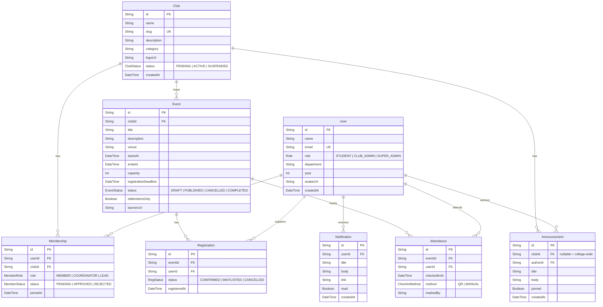
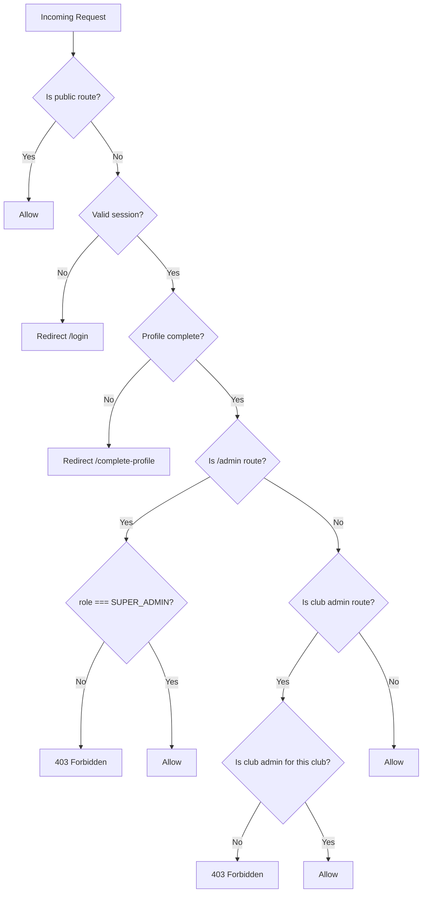

# CampusConnect – Implementation Plan

## Tech Stack Summary

| Layer | Technology |
|---|---|
| Framework | Next.js 14 (App Router) + TypeScript |
| Styling | Tailwind CSS + shadcn/ui |
| Database | Supabase (PostgreSQL) |
| ORM | Prisma |
| Auth | Supabase Auth (email/password, restricted domain) |
| Validation | Zod (shared schemas) + React Hook Form |
| QR | `qrcode` (generation) + `html5-qrcode` (scanning) |
| Deployment | Vercel |

---

## Database Schema (ER Diagram)



---

## Folder Structure

```
campus-connect/
├── .env.example
├── .env.local                    # gitignored
├── README.md
├── next.config.ts
├── tailwind.config.ts
├── tsconfig.json
├── package.json
├── prisma/
│   ├── schema.prisma
│   ├── migrations/
│   └── seed.ts                   # seed script (ts-node)
├── public/
│   └── images/                   # static assets
├── src/
│   ├── app/
│   │   ├── layout.tsx            # root layout (providers, nav, theme)
│   │   ├── page.tsx              # landing / redirect to dashboard
│   │   ├── globals.css
│   │   │
│   │   ├── (auth)/
│   │   │   ├── login/
│   │   │   │   └── page.tsx
│   │   │   ├── signup/
│   │   │   │   └── page.tsx
│   │   │   └── complete-profile/
│   │   │       └── page.tsx
│   │   │
│   │   ├── (dashboard)/          # authenticated layout group
│   │   │   ├── layout.tsx        # sidebar + topbar + auth guard
│   │   │   │
│   │   │   ├── home/
│   │   │   │   └── page.tsx      # student home / overview
│   │   │   │
│   │   │   ├── clubs/
│   │   │   │   ├── page.tsx      # club directory (search/filter)
│   │   │   │   ├── new/
│   │   │   │   │   └── page.tsx  # request new club
│   │   │   │   └── [slug]/
│   │   │   │       ├── page.tsx  # club detail (about, events, announcements)
│   │   │   │       ├── members/
│   │   │   │       │   └── page.tsx  # member list (admin: manage)
│   │   │   │       ├── events/
│   │   │   │       │   ├── page.tsx  # club events list
│   │   │   │       │   └── new/
│   │   │   │       │       └── page.tsx  # create event
│   │   │   │       ├── announcements/
│   │   │   │       │   └── page.tsx
│   │   │   │       └── settings/
│   │   │   │           └── page.tsx  # club settings (admin)
│   │   │   │
│   │   │   ├── events/
│   │   │   │   ├── page.tsx      # global events list (filters)
│   │   │   │   └── [id]/
│   │   │   │       ├── page.tsx  # event detail + register
│   │   │   │       ├── attendance/
│   │   │   │       │   └── page.tsx  # attendance report + scanner
│   │   │   │       └── qr/
│   │   │   │           └── page.tsx  # student's event QR code
│   │   │   │
│   │   │   ├── my-clubs/
│   │   │   │   └── page.tsx
│   │   │   │
│   │   │   ├── my-events/
│   │   │   │   └── page.tsx
│   │   │   │
│   │   │   ├── announcements/
│   │   │   │   └── page.tsx      # combined feed
│   │   │   │
│   │   │   ├── notifications/
│   │   │   │   └── page.tsx
│   │   │   │
│   │   │   ├── profile/
│   │   │   │   └── page.tsx
│   │   │   │
│   │   │   └── admin/            # super admin only
│   │   │       ├── page.tsx      # admin dashboard overview
│   │   │       ├── clubs/
│   │   │       │   └── page.tsx  # approve/suspend clubs
│   │   │       ├── users/
│   │   │       │   └── page.tsx  # manage users
│   │   │       └── announcements/
│   │   │           └── page.tsx  # college-wide announcements
│   │   │
│   │   └── api/
│   │       ├── auth/
│   │       │   └── callback/
│   │       │       └── route.ts  # Supabase auth callback
│   │       ├── clubs/
│   │       │   └── route.ts
│   │       ├── events/
│   │       │   └── route.ts
│   │       ├── attendance/
│   │       │   ├── check-in/
│   │       │   │   └── route.ts  # QR check-in endpoint
│   │       │   └── export/
│   │       │       └── route.ts  # CSV export
│   │       └── notifications/
│   │           └── route.ts
│   │
│   ├── components/
│   │   ├── ui/                   # shadcn/ui components
│   │   ├── layout/
│   │   │   ├── sidebar.tsx
│   │   │   ├── topbar.tsx
│   │   │   ├── mobile-nav.tsx
│   │   │   └── theme-toggle.tsx
│   │   ├── clubs/
│   │   │   ├── club-card.tsx
│   │   │   ├── club-form.tsx
│   │   │   └── member-table.tsx
│   │   ├── events/
│   │   │   ├── event-card.tsx
│   │   │   ├── event-form.tsx
│   │   │   └── registration-button.tsx
│   │   ├── announcements/
│   │   │   ├── announcement-card.tsx
│   │   │   └── announcement-form.tsx
│   │   ├── attendance/
│   │   │   ├── qr-display.tsx
│   │   │   ├── qr-scanner.tsx
│   │   │   └── attendance-table.tsx
│   │   ├── dashboard/
│   │   │   ├── stat-card.tsx
│   │   │   ├── chart-card.tsx
│   │   │   └── activity-feed.tsx
│   │   └── shared/
│   │       ├── empty-state.tsx
│   │       ├── loading-skeleton.tsx
│   │       ├── error-boundary.tsx
│   │       ├── pagination.tsx
│   │       └── search-filter.tsx
│   │
│   ├── lib/
│   │   ├── prisma.ts              # Prisma client singleton
│   │   ├── supabase/
│   │   │   ├── client.ts          # browser client
│   │   │   ├── server.ts          # server client
│   │   │   └── middleware.ts       # auth middleware helper
│   │   ├── auth/
│   │   │   ├── get-session.ts     # helper to get current user
│   │   │   └── require-role.ts    # role guard utility
│   │   ├── qr/
│   │   │   ├── generate.ts        # signed QR token generation
│   │   │   └── verify.ts          # QR token verification
│   │   ├── utils.ts               # general utilities
│   │   └── constants.ts
│   │
│   ├── actions/                   # server actions
│   │   ├── auth.ts
│   │   ├── clubs.ts
│   │   ├── memberships.ts
│   │   ├── events.ts
│   │   ├── registrations.ts
│   │   ├── attendance.ts
│   │   ├── announcements.ts
│   │   └── notifications.ts
│   │
│   ├── schemas/                   # Zod validation schemas
│   │   ├── auth.ts
│   │   ├── club.ts
│   │   ├── event.ts
│   │   ├── announcement.ts
│   │   └── common.ts
│   │
│   ├── hooks/                     # custom React hooks
│   │   ├── use-current-user.ts
│   │   ├── use-notifications.ts
│   │   └── use-debounce.ts
│   │
│   ├── types/
│   │   └── index.ts               # shared TypeScript types
│   │
│   └── middleware.ts              # Next.js middleware (auth + role routing)
```

---

## Route Map

### Public Routes (Unauthenticated)

| Route | Page | Description |
|---|---|---|
| `/` | Landing | Hero, features overview → redirect if logged in |
| `/login` | Login | Email/password login |
| `/signup` | Sign Up | Restricted to college email domain |
| `/complete-profile` | Profile Setup | Department, year, avatar after first login |

### Authenticated Routes (All Roles)

| Route | Page | Min Role |
|---|---|---|
| `/home` | Dashboard Home | STUDENT |
| `/clubs` | Club Directory | STUDENT |
| `/clubs/new` | Request New Club | STUDENT |
| `/clubs/[slug]` | Club Detail | STUDENT |
| `/clubs/[slug]/members` | Member List / Manage | STUDENT (view) / CLUB_ADMIN (manage) |
| `/clubs/[slug]/events` | Club Events | STUDENT |
| `/clubs/[slug]/events/new` | Create Event | CLUB_ADMIN |
| `/clubs/[slug]/announcements` | Club Announcements | STUDENT |
| `/clubs/[slug]/settings` | Club Settings | CLUB_ADMIN (own club) |
| `/events` | All Events | STUDENT |
| `/events/[id]` | Event Detail + Register | STUDENT |
| `/events/[id]/attendance` | Attendance Report + Scanner | CLUB_ADMIN |
| `/events/[id]/qr` | My Event QR Code | STUDENT |
| `/my-clubs` | My Clubs | STUDENT |
| `/my-events` | My Registered Events | STUDENT |
| `/announcements` | Combined Feed | STUDENT |
| `/notifications` | Notifications | STUDENT |
| `/profile` | Edit Profile | STUDENT |

### Super Admin Routes

| Route | Page | Role |
|---|---|---|
| `/admin` | Admin Dashboard | SUPER_ADMIN |
| `/admin/clubs` | Approve / Suspend Clubs | SUPER_ADMIN |
| `/admin/users` | Manage Users / Roles | SUPER_ADMIN |
| `/admin/announcements` | College-wide Announcements | SUPER_ADMIN |

### API Routes

| Endpoint | Method | Purpose |
|---|---|---|
| `/api/auth/callback` | GET | Supabase OAuth callback |
| `/api/clubs` | GET | Paginated club list (public) |
| `/api/events` | GET | Paginated event list |
| `/api/attendance/check-in` | POST | QR check-in (rate-limited) |
| `/api/attendance/export` | GET | CSV download |
| `/api/notifications` | GET | Notification list |

> [!NOTE]
> Most mutations are handled via **Server Actions** (`src/actions/`) rather than API routes, keeping the API surface small.

---

## Security & Permissions Design

### Middleware Chain



### Server Action Permission Checks

Every server action will:
1. Call `getSession()` to verify authentication
2. Validate the user's role against the action's requirements
3. For club-scoped actions, verify the user is an admin/lead of that specific club
4. Validate input with Zod before any database operation
5. Return typed results using a `Result<T, E>` pattern

### Supabase RLS Policies

RLS will be configured as a defense-in-depth layer:
- Users can only read their own profile (write via server actions)
- Club data is readable by all; writable only by club admins and super admins
- Membership data: users can read their own; club admins can read their club's memberships
- Notifications: users can only read/update their own

---

## Key Implementation Details

### Waitlist Logic (Registrations)

```
On Register:
  1. Check deadline not passed
  2. Check not already registered
  3. If isMembersOnly → verify approved membership
  4. Count CONFIRMED registrations
  5. If count < capacity → status = CONFIRMED
  6. Else → status = WAITLISTED
  7. Create notification

On Cancel:
  1. Set registration status = CANCELLED
  2. Find oldest WAITLISTED registration for same event
  3. Promote to CONFIRMED
  4. Create notification for promoted user
```

### QR Attendance Flow

```
Generation:
  - JWT token = sign({ eventId, userId, registrationId }, secret, { expiresIn: eventDuration })
  - Encode as QR code displayed on student's /events/[id]/qr page

Check-in:
  - Club admin opens /events/[id]/attendance → scanner tab
  - Scans student's QR → POST /api/attendance/check-in
  - Server verifies JWT, checks event is active, checks user is registered
  - Creates Attendance record
  - Rate-limited: 1 check-in per user per event
```

### Notification System

```
In-app notifications stored in Notification table.
Created by server actions when:
  - Membership approved/rejected
  - Registration confirmed / waitlist promoted
  - Event published / cancelled / updated
  - Club approved / suspended
  
Email: stubbed behind an INotificationChannel interface for future implementation.
```

---

## Phase Breakdown

### Phase 1: Foundation
- [x] Next.js project init with TypeScript + Tailwind + shadcn/ui
- [x] Prisma schema (all models + enums)
- [x] Supabase project connection + Auth (signup/login/callback)
- [x] College email domain restriction
- [x] Profile completion flow
- [x] Next.js middleware (auth guard + role routing)
- [x] Root layout with sidebar, topbar, theme toggle, dark mode
- [x] Shared components (loading, empty, error states)

### Phase 2: Clubs & Memberships
- [ ] Club directory page (search, filter by category)
- [ ] Club detail page (about, member count, events, announcements)
- [ ] Club creation request form → super admin approval
- [ ] Super admin: approve/suspend clubs page
- [ ] Join club request → club admin approve/reject
- [ ] Member management (roles, remove)
- [ ] "My Clubs" page

### Phase 3: Events & Registrations
- [ ] Event CRUD (club admin: create/edit/publish/cancel)
- [ ] Event list page with filters (club, date, category)
- [ ] Event detail page
- [ ] Registration: one-click register/cancel
- [ ] Capacity enforcement + automatic waitlist promotion
- [ ] Members-only event restriction
- [ ] "My Events" page

### Phase 4: Announcements & Notifications
- [ ] Announcement CRUD (club admin → club, super admin → college-wide)
- [ ] Pinned announcements
- [ ] Combined announcements feed
- [ ] In-app notification system
- [ ] Notification bell in topbar with unread count

### Phase 5: QR Attendance
- [ ] QR token generation (signed JWT per registration)
- [ ] Student QR display page
- [ ] Club admin scanner page (html5-qrcode)
- [ ] Check-in API endpoint (rate-limited)
- [ ] Manual mark/unmark attendance
- [ ] Attendance report per event
- [ ] CSV export

### Phase 6: Dashboards, Seed & Deploy
- [ ] Student dashboard (my clubs, upcoming events, attendance %)
- [ ] Club admin analytics (member growth, registrations vs attendance charts)
- [ ] Super admin overview (totals, trends)
- [ ] Seed script (1 super admin, 3 clubs, 20 students, 10 events, etc.)
- [ ] Permission & waitlist integration tests
- [ ] README with setup steps + .env.example
- [ ] Vercel deployment config

---

## Environment Variables

```bash
# .env.example

# Supabase
NEXT_PUBLIC_SUPABASE_URL=
NEXT_PUBLIC_SUPABASE_ANON_KEY=
SUPABASE_SERVICE_ROLE_KEY=

# Database (Supabase Postgres connection string)
DATABASE_URL=
DIRECT_URL=

# Auth
ALLOWED_EMAIL_DOMAIN=college.edu

# QR Attendance
QR_JWT_SECRET=

# App
NEXT_PUBLIC_APP_URL=http://localhost:3000
```

---

> [!IMPORTANT]
> This plan covers the full architecture. Each phase will be implemented and paused for your review before proceeding to the next. Please review the folder structure, route map, data model, security flow, and phase breakdown, then let me know if you'd like any changes before I begin **Phase 1**.
